# xyz.log

A habit tracker and to-do list that lives in your notes. Everything is plain
markdown in a folder you already own — open it, edit it, `grep` it, sync it
however your vault already syncs. No database, no account, nothing to log into.

One Obsidian plugin plus a Windows desktop widget and an Android app, all reading
and writing the **same three files**, so what you tick off on your phone is there
on your desktop a moment later.



## The idea

Three markdown files in a folder. Every client reads and writes them; any folder
sync (Obsidian Sync, Syncthing, a shared drive — whatever you like) keeps your PC
and phone in step.

- `Habits.md` — habit definitions (YAML frontmatter)
- `Habit Log.md` — one line per completion; streaks and heatmaps are derived, never stored
- `Todo.md` — tasks in the Obsidian **Tasks** plugin's emoji syntax, with sub-folders and descriptions

Because it's all text, your data outlives this project. Full spec:
[docs/DATA_FORMAT.md](docs/DATA_FORMAT.md).



## The clients

- **Obsidian plugin** (`obsidian-plugin/`) — desktop + mobile. A dedicated view
  and drop-in ` ```xyz.log ` blocks for any note. Mobile gets a swipe between
  habits and tasks.
- **Windows widget** (`apps/windows-widget/`) — an always-on desktop gadget
  (Tauri): a modular, tile-based dashboard that pins to the wallpaper, skips the
  taskbar, starts on boot, and fires native notifications.
- **Android app + widgets** (`android-widget/`) — home-screen widgets for habits
  and tasks, a swipeable app, and reminders via `AlarmManager` that survive a
  reboot.

They share one parser and view-model (`packages/core`), so the three stay in
step instead of drifting apart.

## Habits

- **Counters** — do a habit several times a day (water, meds); tap to add,
  with a compact `3⁄5` fraction when there's a daily goal.
- **Streaks with cadence** — "every day" or "every N days", your call.
- **Categories** — habits that share an icon group under a name you can rename inline.
- **GitHub-style heatmap** — the whole history, expandable per habit.
- **Reminders** — one or more times a day; the always-on clients fire the notifications.

## Tasks

- Compatible with the **Tasks** plugin: due dates `📅`, priorities, done `✅`, `#tags`, and `⏰` event times.
- **Sub-folders** — group with `## list` / `### section` headings.
- **Descriptions** — indented lines under a task, with clickable links.
- Two views: grouped **by date** (upcoming above overdue, undated last) or **by folder**.
- **Export from any note** — hover a task list in a note (or use the command
  palette) and pick **Export tasks into xyz.log**: the open tasks land in a
  section named after the note, shown above all the others in the plugin and
  in the widgets, with a button that takes you back to the note.

## Import from TickTick

Moving over from TickTick? In the plugin settings there's **Import from
TickTick**: export your TickTick backup CSV (*Settings → Backup*), pick the file,
and your tasks land in `Todo.md` grouped by list — dates, priorities, tags,
descriptions and completed state included. Your habits are left untouched.

## Modular blocks

Drop a code block in any note and compose what you want (one option per line):

```xyz.log
header
habits
todos
```

| Option | Shows |
|---|---|
| `habits` | the habits section |
| `todos` | the to-do list, grouped by due date |
| `folders` | tasks grouped by **list → section**, with descriptions and links |
| `cross` | the dashboard: tasks left, habits + selectable history right |
| `habit: <id>` | a single habit with its heatmap |
| `header` | a heading with today's date |

An empty block gives you habits + todos. Each block is interactive and
live-updates when the files change. The block language is `xyz.log` (`xyzlog` and
the legacy `todo-habits` still work as aliases, so old notes keep rendering).

## Language

The interface ships in **English** and switches to **Italian** in the plugin
settings (*Settings → xyz.log → Language*).

## Look & feel

Minimal dark, **Roboto Mono** for text and **Space Grotesk** for headings — both
open fonts loaded from Google Fonts, so the project stays redistributable. The
accent follows your Obsidian theme accent, with lighter/softer variants derived
automatically.

## Build — Obsidian plugin

```bash
cd obsidian-plugin
npm install
npm run build
```

Copy `main.js`, `manifest.json` and `styles.css` into
`<vault>/.obsidian/plugins/xyzlog/`, then enable **xyz.log** in *Settings →
Community plugins*. On first run it creates `Habits.md`, `Habit Log.md` and
`Todo.md` in the data folder.

## Build — Windows widget (Tauri)

```bash
cd packages/core && npm install        # shared logic
cd ../../apps/windows-widget && npm install
npm run dev                             # frontend preview at http://localhost:5177
npm run tauri dev                       # native app (needs Rust: https://rustup.rs)
npm run tauri build                     # .exe installer (NSIS)
```

The frontend runs in any browser against sample data; the native build needs the
Rust toolchain.


## Build — Android app

```bash
cd android-widget && ./gradlew assembleDebug   # needs the Android SDK + JDK 17
```

Grant notification permission on first run; reminders use exact alarms and
survive a reboot.

## Status

Everything here works. A few honest caveats on the newer pieces:

- **Obsidian plugin** — solid; this is the one that gets daily use.
- **Shared core** (`packages/core`) — parser, view-model, i18n and reminders, with unit tests.
- **Windows widget** — frontend is done and previewable in a browser; the Rust
  shell (wallpaper pinning, autostart, tray) builds with the Rust toolchain and
  still wants more real-world testing across Windows setups.
- **Android app** — at parity with the core and builds with the Android SDK;
  treat it as beta until it's had more time on real devices.
- The **NType82** headline font (a Nothing typeface) is optional and not shipped —
  the app falls back to Space Grotesk / the system sans without it.

## Structure

```
docs/DATA_FORMAT.md     the shared markdown format
docs/PLAN.md            architecture notes and roadmap
design/tokens.json      shared palette and fonts
packages/core/          shared TypeScript logic (parser, view-model, i18n) + tests
obsidian-plugin/        Obsidian plugin
apps/windows-widget/    Tauri desktop gadget (TS frontend + Rust shell)
android-widget/         Kotlin app + home-screen widgets
```

## License

MIT — see [LICENSE](LICENSE).
