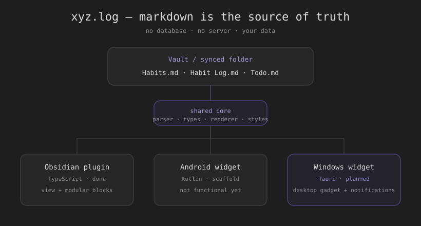

# Project plan — xyz.log

> A **markdown-first** habit & to-do tracker, multi-client, with an always-on desktop
> widget. Goal: replace proprietary trackers (e.g. TickTick) with an open system where
> **your data is yours** (markdown files in your vault), synced everywhere.



## Guiding principle: modularity

Modularity is **the core focus**. Every function (habits, to-dos, history, a single
habit, …) is an **independent module** you compose freely: in the plugin as a
` ```todo-habits ` block with options, in the widget as a tab. The same applies to the
code (`packages/core`, reused by every client) and to the repo: isolated features,
combinable, testable on their own. A "homepage" is just **a composition of modules**, not
a monolith.



## 1. The idea in one line

Three markdown files in a vault are the **single source of truth**; every client (Obsidian
plugin, Android widget, Windows widget) reads and writes them. Any folder sync (Obsidian
Sync or otherwise) keeps everything aligned across PC and phone. No database, no server, no
lock-in.

## 2. Current status

**Obsidian plugin** (`obsidian-plugin/`, TypeScript) — **implemented**:
- dedicated view + embeddable ` ```todo-habits ` block (options `habits`, `todos`,
  `folders`/`cartelle`, `cross`/`croce`, `habit:<id>`, `header`);
- habits with icons (lucide/Iconize), **categories** by icon, **cadence streaks**,
  **GitHub-style heatmap**, **countable** habits (goal N/day);
- to-dos compatible with the **Tasks** plugin (dates `📅`, priorities, done `✅`, tags),
  with **sub-folders** (`## list` / `### section`) and **descriptions** (indented lines,
  markdown links rendered);
- add/rename/delete habits from the UI; grid icon picker;
- **dashboard** layout: to-dos on the left (tall, scrollable), habits top-right and a
  selectable habit's history bottom-right; full-width page;
- command-palette "insert block"; compact UI;
- **i18n**: English (default) / Italian toggle in settings.

**Windows desktop widget** — **planned** (see §4).

**Android widget** (`android-widget/`, Kotlin + Glance) — **early scaffold only, not
functional yet** (source exists but was never built/shipped). Its parser must be kept in
sync with the format.

**Shared format**: `docs/DATA_FORMAT.md`. **TickTick import** (CSV → `Todo.md` with
list/section/description structure; habits → `Habits.md` + `Habit Log.md`) prototyped.

**Fonts**: no proprietary assets — **Space Grotesk** (OFL) for headings, loaded from Google
Fonts.

## 3. Reference architecture

```
            ┌─────────────────────────────────────────────┐
            │     Vault / synced folder (markdown)         │
            │   Habits.md   ·   Habit Log.md   ·   Todo.md │
            └──────────────┬───────────────┬──────────────┘
                           │               │
        ┌──────────────────┼───────────────┼──────────────────┐
   Obsidian plugin     Android widget   Windows widget     (future clients)
   (TS, done)          (Kotlin, scaffold) (Tauri, planned)
```

**Shared core** — today the parser/renderer live only inside the Obsidian plugin. Key
step: extract `parser` + `types` + `renderer` + `styles` into a **`packages/core`**
package (pure TypeScript, no Obsidian deps) reused by the Obsidian plugin, the **Windows
widget** (webview) and a possible web/PWA client.

Proposed monorepo (pnpm workspaces):

```
packages/core/          parser, types, renderer, styles (pure TS)
apps/obsidian-plugin/   Obsidian adapter over core
apps/windows-widget/    Tauri (Rust + webview) over core
android-widget/         Kotlin (mirror parser)
docs/                   format, plan, images
```

## 4. Windows desktop widget

Requirements:
- **starts on startup**;
- **stays in the background on the desktop**, like a gadget;
- **no taskbar entry**;
- **stays visible even on "show desktop" / minimize-all**;
- functions in **separate tabs**, like the TickTick widget but fuller.

### 4.1 Technology

| Option | Code reuse | Footprint | Desktop pinning | Verdict |
|---|---|---|---|---|
| **Tauri** (Rust + webview) | high (reuses the TS renderer) | ~5–10 MB, low RAM | via Win32 in Rust | **recommended** |
| Electron | very high | ~100 MB, high RAM | via native module | ok but heavy for always-on |
| .NET WPF/WinUI | none (XAML rewrite) | low | native, simplest | only if dropping reuse |

**Recommended: Tauri** — a lightweight always-on process showing the same UI as the plugin
(shared `core`), with the OS-level bits written in Rust.

### 4.2 "Desktop gadget" behavior (Windows)

- **No taskbar**: `skip_taskbar` + `WS_EX_TOOLWINDOW` style.
- **Borderless**: `decorations: false`, optional transparency.
- **Pinned to the desktop / survives "show desktop"**: re-parent the window to the
  wallpaper layer (`Progman` → force-create `WorkerW`, then `SetParent` our window to
  `WorkerW`). This is the wallpaper/gadget technique: the window lives behind the desktop
  icons and isn't minimized by "show desktop".
  - Simpler phase-1 variant: an `always_on_bottom`, non-minimizable, taskbar-less window —
    ~90% there, but "show desktop" can still hide it. `WorkerW` pinning is the robust fix.
- **Autostart**: `tauri-plugin-autostart` (writes the registry Run key).
- **Tray**: show/hide, settings, quit.
- **Tabs**: a compact tab bar (Habits · Tasks · Today); the `cross` dashboard is a good
  starting point.

### 4.3 File access

- the user picks the tracker folder (e.g. `vault/allegati/tracker`);
- **watch** the three files (debounced) → re-render on change (incl. from Obsidian/Sync);
- **line-based minimal writes** (like the plugin) to reduce sync conflicts.

## 5. Notifications / reminders

Requirement: **optional** reminders at times of day, set **together** with a habit or an
event when you add a date; habits are **daily**, so on creation you're asked whether you
want a reminder (and at which time(s)).

**Data model (in the markdown, so it syncs everywhere):**
- **Habits** — optional per-habit frontmatter field:
  ```yaml
  - id: minoxidil
    goal: 2
    reminders: ["09:00", "21:00"]   # one notification per time, every day
  ```
- **To-dos / events** — optional time next to the date: `📅 YYYY-MM-DD` + `⏰ HH:mm`
  (kept separate to stay compatible with current parsing).

**Who fires them:** the always-on client.
- **Windows widget**: native toasts (`tauri-plugin-notification`) + a scheduler reading
  times from the markdown.
- **Android**: `AlarmManager` + notifications.
- Obsidian plugin: can notify when open, but isn't reliable for scheduled reminders.

## 6. Open source

- **License**: **MIT** (see `LICENSE`) — maximum adoption and freedom to contribute.
- **Fonts**: solved (Space Grotesk / OFL). Still need to drop the NType82 asset on the
  Android side before shipping (already `gitignored`).
- **CI**: GitHub Actions to build the plugin + widget and publish releases.
- **Contributing**: `CONTRIBUTING.md`, issue templates, `DATA_FORMAT.md` as the contract
  between parsers (kept in sync in TS and Kotlin).
- **Repo**: [`simoliguori/xyz.log`](https://github.com/simoliguori/xyz.log) — **public**,
  MIT.

## 7. Roadmap

- **Phase 0 — done**: shared markdown format, Obsidian plugin (view, blocks, dashboard,
  folders/descriptions, i18n), TickTick import, no proprietary fonts.
- **Phase 1 — OSS foundations**: extract `packages/core`; CI; contributor docs.
- **Phase 2 — Windows widget MVP (Tauri)**: borderless, taskbar-less window; Habits/Tasks/
  Today tabs reading the files.
- **Phase 3 — interactivity**: check habits, add/complete to-dos writing back to markdown.
- **Phase 4 — gadget**: `WorkerW` pinning, autostart, tray, transparency.
- **Phase 5 — notifications**: optional reminders (daily habits + timed events).
- **Phase 6 — Android**: actually build and ship the widget (currently a scaffold).
- **Phase 7 — release**: packaging, docs, v1.0.

## 8. Open decisions

1. **Name**: **xyz.log** (decided; plugin id `xyzlog` since Obsidian ids can't contain a
   dot).
2. **License**: **MIT** (decided).
3. **Repo**: **public** (decided).
4. Monorepo extraction of `packages/core` — when.
